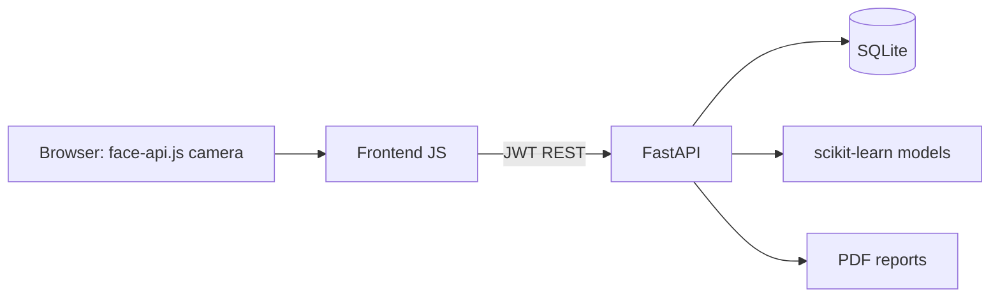

# AutiSphere

AI-based personalised support system for autistic individuals. Team 4 project.

**What works today**

| Area | Implementation |
|---|---|
| Accounts and roles | Register / login (JWT). Roles: parent, teacher (read-only), therapist (edit). |
| Profiles | Multiple people, editable, stored in SQLite as one JSON document each. |
| Face recognition | Enrol a face (6 samples, consent box), then identify who is on camera. Auto-switches to that person's profile. |
| Face expression evaluator | 7 emotions live, smoothed, distress alert using that person's "What helps" list, saved session summaries. |
| ASD screening | AQ-10 scored on the server into Minimal / Mild / Moderate / High, plus a trained classifier probability and a "Why this prediction?" explanation. |
| Model comparison | 7 classifiers + tuned Random Forest, 5-fold CV, accuracy / precision / recall / F1 / ROC-AUC, charts. |
| Stress forecast | Random Forest on a simulated dataset, with per-factor drivers. |
| Language simplifier | Plain-word substitution, sentence splitting, reading grade before and after. |
| Mood tracker, visual schedule | Per-person, saved to the database. |
| PDF reports | One click for parents, teachers or therapists. |

**Not included yet:** voice emotion recognition, conversational chat helper, personalised activity recommender. They are listed in the team split below.

## Quick start

```bash
python -m venv .venv && source .venv/bin/activate      # Windows: .venv\Scripts\activate
pip install -r requirements.txt
python -m ml.generate_data      # synthetic stand-in datasets
python -m ml.train_asd          # model comparison -> models/
python -m ml.train_stress
python -m backend.seed          # demo users + sample profile
uvicorn backend.app.main:app --reload
```

Open <http://localhost:8000> in Chrome or Edge (camera works on localhost). Demo logins: `parent@demo.com`, `therapist@demo.com`, `teacher@demo.com`, password `demo1234`.
The face models download from a CDN the first time, so be online once.
Set `AUTISPHERE_SECRET` to a long random string before sharing the app. Run the tests with `pytest`.
Docker: `docker build -t autisphere . && docker run -p 8000:8000 autisphere`.

## Use the real dataset

1. Download **Autism Screening Adult** from the UCI Machine Learning Repository (or the Kaggle copy). Children, adolescent and toddler sets are on UCI/Kaggle too; check each licence.
2. Save the CSV as `data/Autism-Adult-Data.csv` and run `python -m ml.train_asd --data data/Autism-Adult-Data.csv`.
3. The loader expects the UCI columns `A1_Score` to `A10_Score`, `age`, `gender`, `jundice`, `austim` and the class column last. `models/asd_comparison.csv` and the PNGs are your report tables and figures. Compare your numbers with 3 to 5 published papers on the same dataset.

## Layout

```
backend/app/   main.py (routes), db.py, auth.py, ml.py (inference), nlp.py, reports.py
backend/seed.py
ml/            generate_data.py, train_asd.py, train_stress.py
models/        trained .joblib files, comparison table and charts
frontend/      index.html, css/, js/ (app, people, face, tools, main)
tests/         API tests          docs/  ethics-and-limits.md
```



## Team split

- **Person 1 (ML core):** `ml/`, `models/`, `backend/app/ml.py`. Next: real dataset, SHAP, comparison with papers.
- **Person 2 (vision and audio):** `frontend/js/face.js`. Next: voice emotion (RAVDESS/TESS + librosa), own FER-2013 CNN.
- **Person 3 (full stack):** `backend/`, `frontend/`, deployment. Next: chat helper, activity recommender, HTTPS.

Everyone: report, PPT and demo. See `docs/ethics-and-limits.md`.
